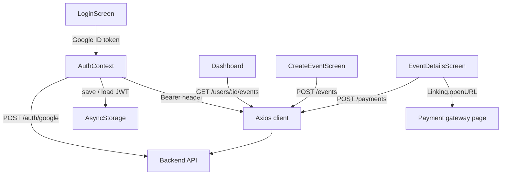

<div align="center">
  <h1>Soirly Mobile</h1>
  <p><em>Expo client prototype for private paid events: sign in, create an event, open the payment page.</em></p>

  
  
  
  
</div>

This is the mobile client of Soirly, my own project for organizing private events where guests pay an entry fee. It talks to the [Soirly backend](https://github.com/yassine-krichen/soirly-private-event-ticketing-backend), a NestJS API that owns invitations, payments and tickets.

It is a prototype, about 650 lines of TypeScript across five screens. It covers the organizer's first steps and the guest's payment hand-off, and nothing more. The backend is ahead of it: invite-by-link join, tickets and check-in exist on the API and have no screens here yet.

## Features

**Authentication** — Google sign-in through `expo-auth-session`; the Google ID token is exchanged for an API JWT, which is kept in AsyncStorage and attached to every request as a Bearer header.

**Auth-gated navigation** — A native-stack navigator renders either the Login screen or the Dashboard and Event Details screens depending on the auth state, with a loading state while the stored token is restored.

**Event creation and listing** — Create an event (title, description, date, location, entry price) and list the events you created.

**Payment hand-off** — Event Details calls `POST /payments` and opens the returned payment URL in the system browser.

**Join by invite** — A Join Event screen exists but is not yet wired into the navigator.

## How It Works



### Key Decisions

- **Auth state in a context, token in storage**: `AuthContext` owns the user and token state and restores it on launch over reading storage in each screen, so navigation is a pure function of auth state.
- **Single Axios instance**: one client with a `setAuthToken` setter over per-call headers, so the Bearer header is set in one place.
- **Typed navigation and path aliases**: `RootStackParamList` and `@/` aliases in `tsconfig.json` (strict mode) over relative imports, so route params are checked at compile time.
- **Payment in the system browser**: the gateway's hosted page opened with `Linking` over an embedded form, which keeps card data out of the app.

## Tech Stack

| Technology | Role | Why |
| --- | --- | --- |
| Expo 54, React Native 0.81, React 19 | App runtime | — |
| React Navigation (native stack) | Navigation | — |
| React Native Paper | UI components | — |
| Axios | HTTP client | — |
| `expo-auth-session`, `expo-web-browser` | Google OAuth flow | — |
| AsyncStorage | Token persistence | — |

## Getting Started

### Prerequisites

- Node.js 20 or newer
- The Soirly backend running locally or deployed
- A Google OAuth client ID

### Install

```bash
git clone https://github.com/yassine-krichen/soirly-private-event-ticketing-frontend.git
cd soirly-private-event-ticketing-frontend
npm install
```

### Configure

```bash
cp .env.example .env
```

### Run

```bash
npm start            # Expo dev server
npm run android
npm run ios
npm run web
```

## Configuration

| Variable | Required | Default | Description |
| --- | --- | --- | --- |
| `EXPO_PUBLIC_API_URL` | Yes | `http://localhost:3000` | Backend base URL |
| `EXPO_PUBLIC_GOOGLE_CLIENT_ID` | Yes | — | Google OAuth client ID |

## Roadmap

| Status | Item |
| --- | --- |
| Done | Google sign-in, token persistence, event creation and listing, payment hand-off |
| Planned | Align the auth call with the backend, which exposes email and password signin today |
| Planned | Ticket screen showing the ticket code as a QR code for door check-in |
| Planned | Organizer check-in and attendee list screens |
| Planned | Component and navigation tests |

## License

Licensed under the [PolyForm Strict License 1.0.0](LICENSE). Source is available to read; use beyond the license terms requires permission from the author.

Built by [Yassine Krichen](https://github.com/yassine-krichen)
